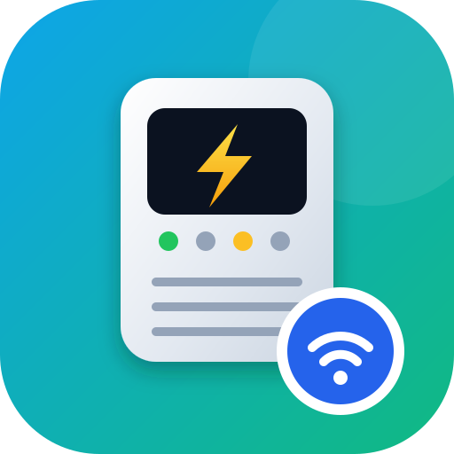
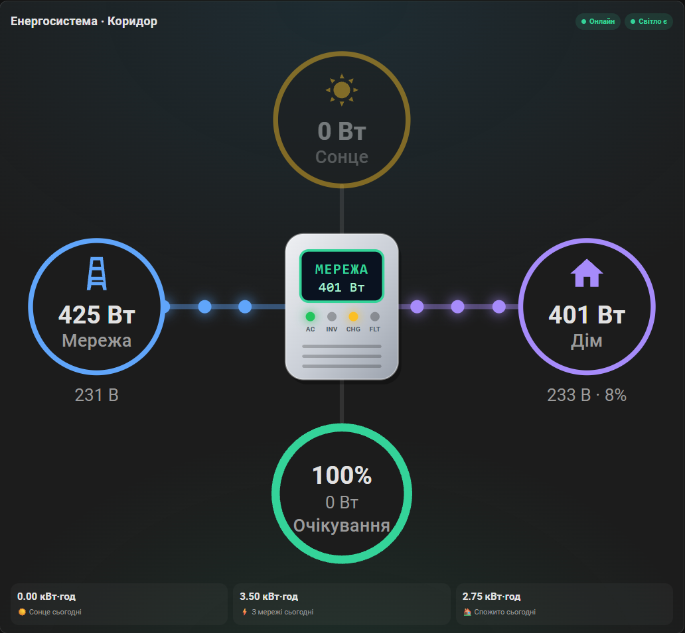

<p align="center">
  
</p>

<h1 align="center">WattSeek BLE</h1>

<p align="center">
  <b>Local, cloud-free Home Assistant integration for JSD Solar / WattSeek hybrid inverters — over Bluetooth.</b><br>
  Monitoring, diagnostics and safe control, straight from your HA host. No cloud, no wiring, no RS-485 adapter.
</p>

<p align="center">
  <a href="https://github.com/hacs/integration"></a>
  <a href="https://github.com/dimagord/wattseek-ble/releases"></a>
  
  
  <a href="LICENSE"></a>
</p>

<p align="center">
  
</p>

---

## Why

The official WattSeek integration polls a cloud API: it's slow, needs internet, and stops working exactly when the power (and the router) goes out. The inverter's logger can also talk **locally** — this integration speaks that local Bluetooth protocol directly, so Home Assistant gets fresh data every few seconds, even offline.

## Features

- 🔌 **Fully local** — Bluetooth Low Energy via HA's own Bluetooth stack (local adapter *or* ESPHome Bluetooth proxy). Auto-discovered.
- ⏱️ **Configurable update interval** — 5 to 600 s (default 30 s).
- 📊 **~70 sensors** — grid, load/output, battery, PV, temperatures, and energy counters (today / month / year / total) ready for the Energy dashboard.
- 🩺 **Human-readable diagnostics** — inverter **Status** (grid / battery / standby / fault …), **Charging stage** (CV / float / equalize), decoded **Faults** and **Warnings**, and a **Problem** binary sensor for notifications. Translated to English and Ukrainian.
- 🎛️ **Safe control** — output & charging priority, operating mode, AC charging current, battery voltage setpoints, grid voltage window and remote power on/off.
- 🛡️ **Guard rails** — writes are **off by default**, ranges follow the inverter manual, ordering rules are enforced (e.g. float < CV), dangerous settings are not exposed at all.
- 🎨 **Optional dashboard card** — animated energy flow with a live inverter "front panel" whose LEDs behave like the real ones.

## How it works

```
Home Assistant ──BLE──► WattSeek logger ──Modbus RTU──► inverter
 (this integration)     (service 0x00FF)  (transparent tunnel)
```

The integration reproduces the app's local protocol (AES‑128 framing, handshake, CRC) and tunnels standard Modbus register reads/writes to the inverter. Details are in [`PROTOCOL.md`](PROTOCOL.md).

## Requirements

- Home Assistant **2024.12** or newer with a working **Bluetooth** integration (a local adapter or an ESPHome Bluetooth proxy within range of the inverter).
- The inverter powered on.
- ⚠️ **Only one BLE client at a time.** Close the WattSeek phone app (or turn off its Bluetooth) while Home Assistant is connected.

> The integration icon is shipped in `brand/` and shows up on Home Assistant **2026.3+**.

## Installation

### HACS (recommended)

1. **HACS → ⋮ → Custom repositories** → add `https://github.com/dimagord/wattseek-ble`, category **Integration**.
2. Install **WattSeek BLE** and **restart Home Assistant**.
3. The logger appears under **Settings → Devices & Services → Discovered**. If it doesn't, use **＋ Add integration → WattSeek BLE**.

### Manual

Copy `custom_components/wattseek_ble/` into `config/custom_components/` and restart Home Assistant.

## Configuration

**Settings → Devices & Services → WattSeek BLE → Configure**

| Option | Default | Description |
|---|---|---|
| Update interval | 30 s | How often the inverter is polled (5–600 s). |
| Allow changing inverter settings | off | Unlocks all writable entities. Leave it off until you've checked that the values shown match your inverter's display. |

## Entities

<details>
<summary><b>Monitoring</b> — grid, load, battery, PV, energy</summary>

| Group | Examples |
|---|---|
| Grid | voltage, frequency, current, power (positive = import) |
| Load / output | active & apparent power, load %, voltage, frequency, current |
| Battery | voltage, current, power (negative = charging), SOC; BMS values when a BMS link exists |
| PV | per-string voltage/current/power, total PV power |
| Energy | output, grid consumption, grid feed-in and PV — today / month / year / total |
| Temperatures | inverter, charger, PV, ambient |

</details>

<details>
<summary><b>Diagnostics</b></summary>

| Entity | Values |
|---|---|
| Status | Power on, Initialization, Standby, Grid mode, Solar mode, Battery mode, Generator mode, Fault, Power off … |
| Charging stage | Not charging, Constant voltage, Float, Equalize |
| Faults | `None` or the list of active faults (overload, overtemperature, bus overvoltage …) |
| Warnings | `None` or the list of active warnings (battery low, BMS lost, fan stalled …) |
| Problem | `on` when any fault or warning is active — handy for notifications |
| Inverter online | BLE link health |

Raw state/fault/alarm codes are available as disabled-by-default diagnostic sensors.

</details>

<details>
<summary><b>Controls</b> (require the write option)</summary>

| Entity | Range / options | Manual program |
|---|---|---|
| Output priority | GPB, PGB, PBG, MKS | 03 |
| Operating mode | APP, UPS, GEN | 04 |
| Charging priority | PNG, OPV, PVF | 05 |
| AC charging current | 2–120 A | 06 |
| Constant charge voltage (CV) | 48.0–58.4 V | 20 |
| Float charge voltage | 50.0–58.0 V, must be below CV | 21 |
| Switch to grid voltage | 40.0–50.0 V, must be below "switch to battery" | 15 |
| Switch to battery voltage | 46.0–58.0 V, must be below CV | 16 |
| Grid low / high voltage | APP/GEN 90–154 / 264–280 V, UPS 170–200 / 264 V | 22 / 23 |
| Remote power | on / off | — |

**Not exposed on purpose:** output voltage/frequency, battery type, grid-tie feed-in, factory reset.

> ⚠️ **Remote power off stops the inverter output** — everything powered by it goes dark, including Home Assistant itself if it runs from the inverter. Put a confirmation on any dashboard button for it.
>
> ⚠️ Without PV panels, **OPV (Only PV)** charging priority means the battery never charges.

</details>

## Dashboard card (optional)

[`extras/wattseek-flow-card.js`](extras/wattseek-flow-card.js) is a dependency-free Lovelace card: animated power flow between grid, home, battery and PV, with an inverter in the middle that shows the current mode on its screen and mirrors the real front-panel LEDs (AC, INV, CHG, FLT).

1. Copy the file to `config/www/` and add it as a dashboard resource: `/local/wattseek-flow-card.js`, type **JavaScript module**.
2. Add the card and point it at your entities:

```yaml
type: custom:wattseek-flow-card
title: Energy
grid: sensor.wattseek_grid_power
load: sensor.wattseek_load_active_power
batt: sensor.wattseek_battery_power
soc: sensor.wattseek_battery_soc
gv: sensor.wattseek_grid_voltage
ov: sensor.wattseek_output_voltage
pct: sensor.wattseek_output_load_percentage
online: binary_sensor.wattseek_inverter_online
gridok: binary_sensor.wattseek_grid_connected
status: sensor.wattseek_status
stage: sensor.wattseek_charging_stage
faults: sensor.wattseek_faults
alarms: sensor.wattseek_alarms
problem: binary_sensor.wattseek_problem
grid_today: sensor.wattseek_grid_consumption_today
out_today: sensor.wattseek_output_energy_today
```

Alternatively set `prefix: sensor.<your_device>` and the card derives the entity ids itself.

## Troubleshooting

| Symptom | What to check |
|---|---|
| Logger not discovered | Is the phone app disconnected? Is the inverter within range of your adapter / proxy? |
| Entities unavailable after an update | Custom integrations need a **full HA restart** — reloading the entry is not enough. |
| "Changing inverter settings is disabled" | Enable the write option in the integration settings. |
| Logger disappeared from BLE scans | A stale connection can stop it advertising. Reloading the Bluetooth integration (or restarting HA) frees it. |

Debug logging prints every BLE frame:

```yaml
logger:
  logs:
    custom_components.wattseek_ble: debug
```

Please attach a short excerpt (handshake + one poll cycle) when opening an [issue](https://github.com/dimagord/wattseek-ble/issues).

## Українською

Локальна інтеграція Home Assistant для гібридних інверторів JSD Solar / WattSeek через Bluetooth, без хмари. Дає моніторинг, зрозумілу діагностику українською (стан, етап заряду, аварії, попередження) і безпечне керування. Запис вимкнений за замовчуванням, діапазони взято з інструкції інвертора. Встановлення — через HACS (кастомний репозиторій), далі перезапуск HA. Не забудьте закрити застосунок WattSeek на телефоні: логер приймає лише одне BLE-з'єднання.

## Credits & disclaimer

- Register map based on the published JSD Solar Modbus protocol and the community ESPHome JSDSolar configuration.
- Inspired by the cloud integration [home-assistant-wattseek](https://github.com/nazeehrai/home-assistant-wattseek).
- The local protocol was reverse-engineered for interoperability with the owner's own hardware.

This project is unofficial and not affiliated with WattSeek, CVTE or JSD Solar. Changing inverter settings can damage equipment or batteries — use the write option deliberately and at your own risk.

Licensed under the [MIT License](LICENSE).
